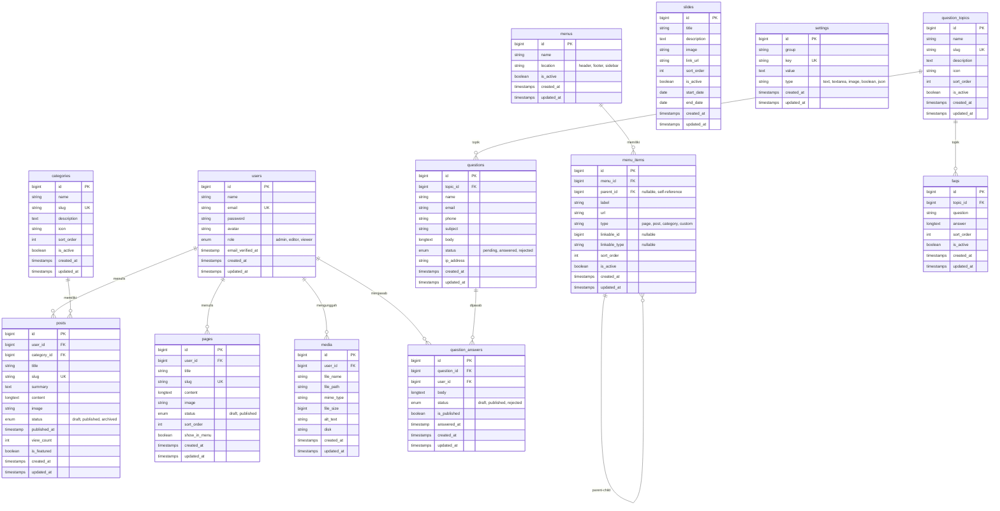
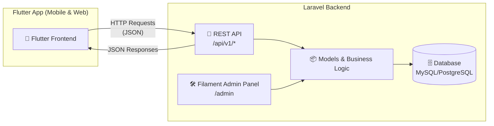

# 📋 Rencana Aksi: Aplikasi CMS & Pertanyaan Masyarakat

> Aplikasi Laravel 13 + Filament v5.11 sebagai backend (Admin Panel + REST API) untuk mengelola konten profil instansi dan menerima pertanyaan dari masyarakat. Frontend publik akan dibangun terpisah menggunakan **Flutter**.

---

## 🗂️ Entity Relationship Diagram (ERD)



---

## 🏛️ Arsitektur Sistem (API-First)



---

## 🏗️ Arsitektur Modul

### Modul 1: CMS (Content Management System)

| Fitur | Deskripsi |
|-------|-----------|
| **Manajemen Post/Artikel** | CRUD artikel dengan kategori, gambar unggulan, status draft/publish/archived, rich text editor |
| **Manajemen Halaman Statis** | Halaman seperti "Tentang Kami", "Visi Misi", "Struktur Organisasi" |
| **Manajemen Kategori** | Pengelompokan artikel berdasarkan kategori |
| **Manajemen Media** | Upload & kelola gambar dan file |
| **Manajemen Menu** | Menu navigasi dinamis untuk header, footer, sidebar |
| **Manajemen Slide** | Slide promosi di halaman utama dengan jadwal tayang |
| **Pengaturan Situs** | Nama instansi, logo, alamat, kontak, media sosial |

### Modul 2: Pertanyaan Masyarakat

| Fitur | Deskripsi |
|-------|-----------|
| **Form Pertanyaan Publik** | REST API endpoint untuk masyarakat mengirim pertanyaan (dikonsumsi Flutter) |
| **Topik Pertanyaan** | Kategori topik pertanyaan (pelayanan, administrasi, dll) |
| **Manajemen Pertanyaan** | Admin review, jawab, atau tolak pertanyaan |
| **FAQ** | Kumpulan pertanyaan yang sering diajukan per topik |
| **Notifikasi Email** | Notifikasi ke penanya ketika pertanyaan dijawab |

---

## 📦 Tahapan Implementasi

### Fase 1: Fondasi & Konfigurasi ⏱️ ~2 hari

- [x] Install Laravel 13 + Filament v5
- [x] Konfigurasi database (`.env`)
- [x] Setup Filament Admin Panel (tema, warna, branding)
- [x] Konfigurasi role & permission pada model User
- [x] Buat migration untuk tabel `settings`
- [x] Buat `SettingResource` di Filament

### Fase 2: Modul CMS ⏱️ ~5 hari

- [x] **Kategori**
  - [x] Buat Model, Migration, Factory, Seeder
  - [x] Buat `CategoryResource` (Filament)
- [x] **Post/Artikel**
  - [x] Buat Model, Migration, Factory, Seeder
  - [x] Buat `PostResource` (Filament) dengan rich text editor
  - [x] Implementasi slug otomatis, featured image, status filter
- [x] **Halaman Statis**
  - [x] Buat Model, Migration, Factory, Seeder
  - [x] Buat `PageResource` (Filament)
- [x] **Media Library**
  - [x] Buat Model, Migration
  - [x] Buat `MediaResource` di Filament
- [x] **Menu & Menu Items**
  - [x] Buat Model, Migration, Seeder
  - [x] Buat `MenuResource` dengan nested menu items (Repeater)
- [x] **Slide**
  - [x] Buat Model, Migration, Factory, Seeder
  - [x] Buat `SlideResource` (Filament)

### Fase 3: Modul Pertanyaan Masyarakat ⏱️ ~3 hari

- [x] **Topik Pertanyaan**
  - [x] Buat Model, Migration, Factory, Seeder
  - [x] Buat `QuestionTopicResource` (Filament)
- [x] **Pertanyaan**
  - [x] Buat Model, Migration, Factory, Seeder
  - [x] Buat `QuestionResource` (Filament) dengan filter status
  - [x] Implementasi validasi & rate limiting pada API
- [x] **Jawaban Pertanyaan**
  - [x] Buat Model, Migration
  - [x] Integrasikan jawaban sebagai Relation Manager di `QuestionResource`
  - [x] Kirim notifikasi email ke penanya (`QuestionAnsweredNotification`)
- [x] **FAQ**
  - [x] Buat Model, Migration, Factory, Seeder
  - [x] Buat `FaqResource` (Filament)

### Fase 4: REST API untuk Flutter ⏱️ ~4 hari

- [x] Install & konfigurasi Laravel Sanctum untuk autentikasi API
- [x] **API Publik (tanpa auth)**
  - [x] `GET /api/v1/posts` — Daftar artikel (pagination, filter kategori, search)
  - [x] `GET /api/v1/posts/featured` — Daftar artikel unggulan
  - [x] `GET /api/v1/posts/{slug}` — Detail artikel & view counter
  - [x] `GET /api/v1/pages` & `/api/v1/pages/{slug}` — Detail halaman statis
  - [x] `GET /api/v1/categories` — Daftar kategori
  - [x] `GET /api/v1/slides` — Daftar slide aktif
  - [x] `GET /api/v1/menus/{location}` — Menu berdasarkan lokasi (header/footer/sidebar)
  - [x] `GET /api/v1/settings` — Pengaturan situs (nama, logo, kontak, dll)
  - [x] `GET /api/v1/faqs` — Daftar FAQ (filter per topik & search)
  - [x] `GET /api/v1/question-topics` — Daftar topik pertanyaan
  - [x] `GET /api/v1/questions` — Daftar pertanyaan yang sudah dijawab (publik)
  - [x] `POST /api/v1/questions` — Kirim pertanyaan baru (validasi + throttle/rate limit)
- [x] Buat API Resource classes (`PostResource`, `SlideResource`, dll) untuk response formatting
- [x] Implementasi API versioning (`/api/v1/...`)
- [x] CORS configuration untuk akses dari Flutter (`config/cors.php`)

### Fase 5: Polish & Deployment ⏱️ ~2 hari

- [x] Dashboard widget (statistik artikel, pertanyaan masuk, dll: `StatsOverviewWidget`, `LatestQuestionsWidget`, `LatestPostsWidget`)
- [x] Optimasi performa API (eager loading, query scoping)
- [x] Testing (unit & feature tests: 14 tests, 51 assertions passed)
- [ ] Deployment & konfigurasi server production

---

## 🗃️ Struktur File yang Akan Dibuat

```
app/
├── Models/
│   ├── User.php (modifikasi: tambah role)
│   ├── Category.php
│   ├── Post.php
│   ├── Page.php
│   ├── Media.php
│   ├── Menu.php
│   ├── MenuItem.php
│   ├── Slide.php
│   ├── Setting.php
│   ├── Question.php
│   ├── QuestionAnswer.php
│   ├── QuestionTopic.php
│   └── Faq.php
├── Filament/
│   ├── Resources/
│   │   ├── CategoryResource.php
│   │   ├── PostResource.php
│   │   ├── PageResource.php
│   │   ├── MediaResource.php
│   │   ├── MenuResource.php
│   │   ├── SlideResource.php
│   │   ├── SettingResource.php
│   │   ├── QuestionResource.php
│   │   ├── QuestionTopicResource.php
│   │   └── FaqResource.php
│   └── Widgets/
│       ├── StatsOverviewWidget.php
│       ├── LatestQuestionsWidget.php
│       └── LatestPostsWidget.php
├── Http/
│   ├── Controllers/
│   │   └── Api/
│   │       └── V1/
│   │           ├── PostController.php
│   │           ├── PageController.php
│   │           ├── CategoryController.php
│   │           ├── SlideController.php
│   │           ├── MenuController.php
│   │           ├── SettingController.php
│   │           ├── QuestionController.php
│   │           ├── QuestionTopicController.php
│   │           └── FaqController.php
│   └── Resources/
│       └── Api/
│           └── V1/
│               ├── PostResource.php
│               ├── PageResource.php
│               ├── CategoryResource.php
│               ├── SlideResource.php
│               ├── MenuResource.php
│               ├── MenuItemResource.php
│               ├── SettingResource.php
│               ├── QuestionResource.php
│               ├── QuestionTopicResource.php
│               ├── QuestionAnswerResource.php
│               └── FaqResource.php
└── Notifications/
    └── QuestionAnsweredNotification.php

database/
├── migrations/
│   ├── xxxx_create_categories_table.php
│   ├── xxxx_create_posts_table.php
│   ├── xxxx_create_pages_table.php
│   ├── xxxx_create_media_table.php
│   ├── xxxx_create_menus_table.php
│   ├── xxxx_create_menu_items_table.php
│   ├── xxxx_create_slides_table.php
│   ├── xxxx_create_settings_table.php
│   ├── xxxx_create_question_topics_table.php
│   ├── xxxx_create_questions_table.php
│   ├── xxxx_create_question_answers_table.php
│   └── xxxx_create_faqs_table.php
├── factories/
└── seeders/

routes/
└── api.php (REST API routes)
```

---

## ⚙️ Tech Stack

| Komponen | Teknologi |
|----------|-----------|
| Backend Framework | Laravel 13 |
| Admin Panel | Filament v5.11 |
| PHP | 8.3+ |
| Database | MySQL / PostgreSQL |
| API Authentication | Laravel Sanctum (token-based) |
| Rich Text Editor | Filament TipTap Editor |
| File Storage | Laravel Filesystem (local/S3) |
| Notifikasi | Laravel Notifications (email) |
| API Documentation | Scramble / Postman Collection |
| Frontend (terpisah) | Flutter (mobile & web) |

---

> [!TIP]
> Mulai dari **Fase 1** terlebih dahulu. Setelah fondasi siap, kita bisa langsung mengeksekusi pembuatan model, migration, dan Filament Resources secara bertahap.

> [!IMPORTANT]
> Pastikan database sudah dikonfigurasi di file `.env` sebelum memulai migrasi. Jalankan `php artisan migrate` setelah setiap fase migration selesai.

> [!NOTE]
> Arsitektur ini menggunakan pola **API-first**: Laravel sebagai backend murni (Admin Panel + REST API), sementara Flutter mengkonsumsi data melalui REST API. Tidak ada Blade views atau Livewire di sisi publik.

